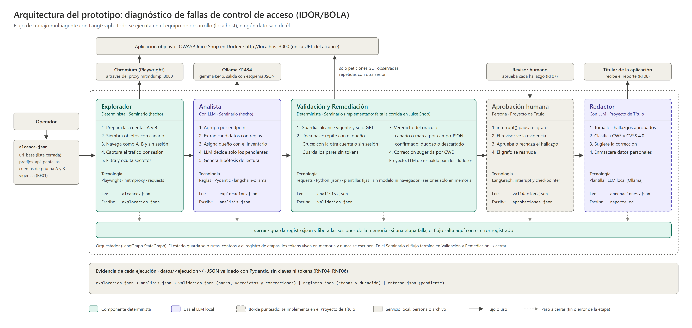

# Arquitectura detallada del prototipo

Sistema multiagente defensivo que diagnostica fallas de control de acceso (IDOR/BOLA) en aplicaciones web y APIs. Este documento detalla la arquitectura lógica del prototipo: qué hace cada agente, con qué tecnología, qué datos intercambia y su pseudocódigo.



La imagen está también como vector en [arquitectura.svg](arquitectura.svg), por si hay que editarla o ampliarla para el informe.

## 1. Alcance de este documento

El Seminario implementa tres agentes, coordinados por un orquestador:

| Agente | Tipo | Estado al 16 de noviembre de 2026 |
|---|---|---|
| Explorador | Determinista | Implementado y probado contra Juice Shop |
| Analista | Con LLM | Implementado y probado contra Juice Shop |
| Validación y Remediación | Determinista | Implementado; probado solo con una aplicación simulada. **Falta la corrida contra Juice Shop** |

Quedan para el Proyecto de Título: el LLM de respaldo para los resultados dudosos, la aprobación humana (RF07), el Redactor del reporte (RF08), las pruebas verticales (BFLA), las escrituras, crAPI y la aplicación propia. Su pseudocódigo (sección 8) es una propuesta.

**Nombres antiguos y actuales.** El informe v9 y la primera versión de este documento hablaban de un Ejecutor y un Juez. En el código ya no existen con esos nombres: son un solo agente, Validación y Remediación, que además entrega la corrección sugerida de cada hallazgo confirmado.

| Nombre antiguo | Nombre actual | Archivo |
|---|---|---|
| Ejecutor | Validación y Remediación, pasos 1 y 2 (guardia y cruce) | `cruce.py` |
| Juez (etapa determinista) | Validación y Remediación, paso 3 (oráculo) | `oraculo.py` |
| — | Validación y Remediación, paso 4 (corrección sugerida) | `remediacion.py` |
| `ejecucion.json` y `veredictos.json` | `validacion.json` | — |
| Nodos `ejecutor` y `juez` | Nodo `validacion` | `grafo.py` |
| Juez con LLM (Proyecto) | LLM de respaldo para los dudosos | — |

La Tabla 6.1 y la sección 8.4 del informe deben actualizarse con estos nombres.

## 2. Principios de diseño

1. **Flujo de trabajo, no agente autónomo.** El orden de las etapas está fijado en el código; el LLM solo decide donde hay que interpretar la aplicación.
2. **El LLM nunca confirma una fuga.** La confirmación la hace un oráculo determinista con datos canario o con el inventario; lo que el oráculo no puede decidir queda como "dudoso".
3. **Lista cerrada.** Toda petición se construye a partir de `url_base` del archivo de alcance. Ningún componente acepta una URL de otra fuente.
4. **Solo lectura sobre lo observado.** Solo se repiten peticiones GET que el Explorador ya observó, sin alterar identificadores, sin enumerar y sin recorrer rutas nuevas.
5. **Secretos fuera del disco.** Tokens y claves viven solo en memoria; la evidencia y el estado del grafo no los contienen (RNF06).
6. **Etapas en secuencia.** El navegador, el modelo y las peticiones cruzadas nunca coinciden en memoria (RNF03).
7. **Cada etapa deja evidencia.** Todo resultado se guarda como JSON validado, de modo que cualquier métrica pueda recalcularse (RNF04).
8. **Las respuestas son datos.** El contenido de la aplicación evaluada nunca se interpreta como instrucción (RNF05).

## 3. Componentes

| Componente | Función | Entrada | Salida | Tecnología |
|---|---|---|---|---|
| Orquestador | Ejecuta las etapas en orden, mantiene el estado, registra cada etapa y cierra ordenadamente ante un error | `alcance.json` | `registro.json` | LangGraph |
| Explorador | Prepara las cuentas, siembra canarios, navega como A, B y sin sesión, captura y filtra el tráfico | `alcance.json` | `exploracion.json` | Playwright, mitmproxy, requests |
| Analista | Agrupa endpoints, extrae candidatos con reglas, asigna dueño con el inventario, consulta al LLM los pendientes y genera hipótesis | `exploracion.json` | `analisis.json` | Reglas en Python, Pydantic, langchain-ollama, Ollama |
| Validación y Remediación | Repite cada petición con el dueño y con la sesión cruzada, clasifica el resultado y sugiere la corrección | `analisis.json`, sesiones en memoria | `validacion.json` | requests, Python (`json`), plantillas fijas |
| Aprobación humana (Proyecto) | Aprueba o rechaza cada hallazgo antes del reporte | `validacion.json` | `aprobaciones.json` | LangGraph (`interrupt` y checkpointer persistente) |
| Redactor (Proyecto) | Escribe el reporte con evidencia, CWE, CVSS 4.0 y corrección | `aprobaciones.json` | `reporte.md` | Plantilla y LLM local |

Archivos de cada agente en `prototipo/prototipo/`:

| Agente | Módulo principal | Pasos |
|---|---|---|
| Orquestador | `grafo.py` | — |
| Explorador | `explorador.py` | `juice_shop.py` (adaptador), `captura.py`, `filtro.py` |
| Analista | `analista.py` | `endpoints.py`, `extraccion.py`, `propiedad.py`, `clasificador.py`, `hipotesis.py` |
| Validación y Remediación | `validacion.py` | `cruce.py` (pasos 1 y 2), `oraculo.py` (paso 3), `remediacion.py` (paso 4) |

## 4. Tecnologías

Las versiones son las fijadas en el Anexo D del informe y coinciden con las instaladas en el entorno virtual de `prueba_concepto` (leídas de sus metadatos).

| Tecnología | Versión | Dónde se usa | Para qué |
|---|---|---|---|
| Python | 3.13 | Todo el sistema | Lenguaje del prototipo |
| LangGraph | 1.2.18 | Orquestador | Grafo de estados, aristas condicionales, puntos de control |
| Pydantic | 2.14.2 | Todos | Contratos de datos y validación de la evidencia |
| Playwright para Python | 1.64.1 | Explorador | Navegar la interfaz como A, B y sin sesión |
| mitmproxy (`mitmdump`) | 12.3.1 | Explorador | Registrar el tráfico HTTP del navegador |
| requests | 2.34.2 | Explorador (preparación), Validación y Remediación | Sembrar objetos y repetir peticiones |
| langchain-ollama | 1.1.0 | Analista | `ChatOllama` con salida estructurada (`json_schema`) |
| Cliente `ollama` | 0.6.3 | Analista | Verificar el modelo y liberarlo de la memoria |
| Ollama (servidor) | 0.40 | Analista; LLM de respaldo y Redactor en el Proyecto | Servir el modelo en `localhost:11434` |
| Gemma 4 E4B (`gemma4:e4b`) | — | Analista | Modelo principal; Qwen3.5-4B como contraste |
| Docker Desktop | Vigente | Laboratorio | OWASP Juice Shop (y crAPI en el Proyecto) |
| Faker | 40.44.0 | Explorador | Datos ficticios de las cuentas de prueba |
| FastAPI y Uvicorn | 0.162.0 y 0.54.0 | Proyecto | Aplicación propia con fallas sembradas |
| ZAP | 2.17.0 | Proyecto | Línea base de la evaluación (H1) |

Notas de compatibilidad:

- El agente de Validación y Remediación **no agrega dependencias**: usa `requests`, `pydantic` y la biblioteca estándar (`json`, `urllib.parse`, `time`).
- El requisito mínimo de Python lo fija mitmproxy (3.12 o superior).
- La aprobación humana del Proyecto necesitará un checkpointer persistente. Hoy el grafo usa `InMemorySaver`, que pierde el estado al cerrar el proceso. El paquete candidato es `langgraph-checkpoint-sqlite`; su versión compatible con LangGraph 1.2.18 **debe verificarse al momento de implementarlo**.
- No se verificó en la web el soporte vigente de cada versión el 16 de noviembre de 2026; la referencia sigue siendo el Anexo D.

## 5. Contratos de datos

Todos los modelos están en `prototipo/prototipo/modelos.py`.

### 5.1 Alcance

```text
Alcance   aplicacion, url_base, prefijos_api[], pantallas[], cuentas[], proxy,
          vigencia_desde?, vigencia_hasta?, autorizado_por        # RF01; sin fechas no hay límite
          comprobar_vigencia()  -> error si hoy queda fuera de la autorización
```

`alcance_juice.json` todavía no trae las fechas: hay que agregarlas con las de la autorización del laboratorio.

### 5.2 Explorador y Analista

```text
ResultadoExploracion ejecucion, fecha, aplicacion, cuentas[], inventario[], peticiones[], descartadas{}
  ObjetoSembrado     cuenta, tipo, id, canario?, endpoint?
  PeticionCapturada  id, sesion, host, metodo, ruta, consulta, cuerpo_peticion,
                     estado, tipo_contenido, cuerpo_respuesta, autenticada
ResultadoAnalisis    ejecucion, fecha, modo, modelo?, endpoints[], candidatos[], hipotesis[],
                     omitidas{}, consultas_llm, duracion_s
  Candidato          peticion, endpoint, sesion, parametro, valor, ubicacion,
                     decidido_por?, es_identificador?, visibilidad?, cuenta_duena?, objeto?
  Hipotesis          id, tipo(horizontal|sin_sesion), endpoint, peticion_origen, sesion_origen,
                     sesion_prueba, cuenta_duena, parametro?, valor?, ubicacion?, objeto?, origen,
                     verificacion(canario|inventario|sin_verificacion), canario?, marca_dueno?
```

### 5.3 Validación y Remediación

```text
Respuesta
  estado         : int | None      # None si hubo error de red
  tipo_contenido : str
  cuerpo         : str             # con los secretos ocultos ("***")
  recortado      : bool            # el cuerpo superó el máximo y se cortó
  duracion_ms    : int
  error          : str | None

ParCruzado
  hipotesis      : str             # id de la Hipotesis, p. ej. H-001
  metodo         : "GET"
  ruta           : str             # ruta y consulta relativas a la URL base
  sesion_base    : "A" | "B"       # dueño
  sesion_prueba  : "A" | "B" | "anonima"
  base           : Respuesta | None
  cruce          : Respuesta | None
  omitida        : str | None      # motivo por el que la guardia no dejó enviar

Remediacion
  cwe, debilidad, recomendacion

Veredicto
  hipotesis, tipo, endpoint
  clase          : "confirmado" | "dudoso" | "descartado"     # RF06
  motivo         : str             # código fijo, ver sección 7.4
  evidencia      : str             # el canario, o el campo y su valor
  decidido_por   : "canario" | "inventario" | "regla"
  remediacion    : Remediacion | None                         # solo en los confirmados

ResultadoValidacion
  ejecucion, fecha, pares[], veredictos[], resumen{clase: cantidad},
  enviadas, omitidas{motivo: cantidad}, duracion_s
```

### 5.4 Pendiente: `entorno.json` (RNF04)

```text
ejecucion, fecha, equipo{so, cpu, ram, gpu}, python, paquetes{nombre: version},
ollama{version, modelo, digest, opciones}, aplicacion{nombre, version}, hash_alcance
```

### 5.5 Adaptador de aplicación

Lo que depende de la aplicación evaluada está en `juice_shop.py`. Para crAPI y la aplicación propia se escribirá otro módulo con las mismas funciones.

```text
verificar_disponible(url_base)       -> None | error
preparar(alcance)                    -> {nombre: SesionPreparada}   # registra, inicia sesión, siembra
cabeceras(sesion | None)             -> dict                        # Authorization y cookie "token"; vacío sin sesión
ENDPOINTS  : {tipo_objeto: plantilla}
PARAMETROS : {nombre_parametro: tipo_objeto}
```

Pendiente: el inicio de sesión del navegador sigue dentro de `captura.py`, y `explorador.py`, `propiedad.py` y `cruce.py` importan `juice_shop` directamente. Cuando exista un segundo adaptador, el alcance deberá nombrar cuál usar.

## 6. Orquestador

**Archivo:** `grafo.py`. **Tecnología:** LangGraph (`StateGraph`, aristas condicionales, `InMemorySaver`).

```text
ESTADO (solo datos serializables y sin secretos)
  ruta_alcance, ejecucion, modo_analista
  ruta_exploracion, ruta_analisis, ruta_validacion
  resumen_exploracion, resumen_analisis, resumen_validacion
  error
  registro[]            # una entrada por etapa; se acumula

SESIONES ← {}           # ejecucion -> sesiones con token; solo en memoria

cada nodo:
    inicio ← ahora()
    intentar: resultado ← trabajo del agente
    si falla con error e:
        devolver {error: etapa + ": " + e, registro: [entrada(etapa, inicio, "error", e)]}
    devolver {ruta de la evidencia, resumen, registro: [entrada(etapa, inicio, "ok", resumen)]}

GRAFO DEL SEMINARIO
    INICIO → explorador
    explorador → analista      (o cerrar, si hubo error)
    analista   → validacion    (o cerrar, si hubo error)
    validacion → cerrar
    cerrar     → FIN

nodo cerrar:
    carpeta ← datos/<ejecucion>            # o <fecha>_fallida si no hubo ejecución
    guardar registro.json ← {ejecucion, error, etapas: estado.registro}
    SESIONES.quitar(ejecucion)             # los tokens dejan de existir
```

## 7. Agentes del Seminario

En el pseudocódigo, **[aplicada]** marca una corrección de la revisión del 16 de noviembre que ya está en el código, y **[pendiente]**, una que falta.

### 7.1 Explorador

**Tecnología:** requests (preparación), Playwright (navegación), mitmproxy (captura).

```text
función explorar(alcance) -> (ResultadoExploracion, sesiones):
    alcance.comprobar_vigencia()                                   # [aplicada] RF01
    sesiones  ← preparar(alcance)
    capturadas ← capturar(alcance, sesiones)
    conservadas, descartadas ← filtrar(capturadas, alcance)
    guardar exploracion.json ← {cuentas, inventario, conservadas, descartadas}
    devolver resultado, sesiones                                   # las sesiones no se guardan

función preparar(alcance):                                         # adaptador de Juice Shop
    verificar que la aplicación responde
    para cada cuenta en alcance.cuentas:
        registrar la cuenta (si ya existe, continuar)
        iniciar sesión → token, id_usuario
        inventario ← [usuario, canasta]
        crear dirección con canario "Canario-<cuenta>-<8 hex>" → inventario
        crear tarjeta con otro canario                           → inventario
        agregar un producto a la canasta                         → inventario
        anotar en cada objeto la plantilla del endpoint que lo entrega
    devolver {cuenta: SesionPreparada(cuenta, token, inventario)}

función capturar(alcance, sesiones):
    archivo ← temporal.mitm
    intentar:
        proxy ← arrancar mitmdump en el puerto del alcance, escribiendo en archivo
        navegador ← Chromium con proxy
        para cada sesión en [A, B, anónima]:
            contexto ← nuevo contexto con cabecera X-Sesion = sesión
            si no es anónima: iniciar sesión en la interfaz
            para cada pantalla del alcance (completada con ids del inventario):
                ir a la pantalla y esperar 3 s
        detener proxy
        devolver leer(archivo) → PeticionCapturada (sesión, método, ruta, consulta, cuerpos, estado)
    finalmente:
        borrar archivo            # [aplicada] contiene tokens: se borra aunque algo falle (RNF06)

función filtrar(peticiones, alcance):
    para cada p:
        motivo ← primero que aplique:
            host distinto al de url_base            → "fuera_del_alcance"
            estado 101                              → "websocket"
            ruta sin prefijo de prefijos_api        → "recurso_estatico"
            estado 304 o respuesta vacía            → "sin_contenido"
            tipo de contenido sin "json"            → "no_json"
            misma sesión, método, ruta y cuerpo     → "duplicada"
        si hay motivo: contar y descartar
        si no: ocultar secretos en ambos cuerpos y conservar
               # [pendiente] ocultar también en cuerpos de formulario y en la consulta
    devolver conservadas, descartadas
```

### 7.2 Analista

**Tecnología:** reglas en Python, Pydantic, `ChatOllama` con `with_structured_output(Decision, method="json_schema")`, modelo `gemma4:e4b` con temperatura 0, semilla 42 y contexto de 4.096 tokens.

```text
función analizar(ruta_exploracion, modo) -> ResultadoAnalisis:
    r ← leer exploracion.json
    candidatos ← extraer(r.peticiones)                       # paso 2: reglas
    candidatos ← resolver(candidatos, inventario)            # paso 3: inventario
    pendientes ← candidatos sin decidir
    # [pendiente] no consultar al modelo los candidatos de peticiones que no son GET
    si modo = "reglas_llm" y hay pendientes:
        verificar que Ollama tiene el modelo
        clasificador ← Clasificador(r.cuentas)
    intentar:
        candidatos ← decidir_pendientes(candidatos, clasificador)   # paso 4: LLM
    finalmente:
        liberar el modelo de la memoria                      # RNF03
    hipotesis, omitidas ← generar(r, candidatos)             # paso 5
    guardar analisis.json

función extraer(peticiones):                                 # solo mira la PETICIÓN, nunca la respuesta
    para cada petición de las sesiones A y B:
        ruta:     segmentos con forma de id (número, UUID, hexadecimal largo, token)
        consulta: parámetros con nombre o valor de identificador
        cuerpo:   claves JSON con nombre o valor de identificador
        descartar nombres de paginación, orden y filtro (page, limit, q, quantity…)
        # [aplicada] nombre de identificador: id, uid, uuid, *_id, *_uuid, *Id, *ID.
        #            "paid", "valid" o "android" ya no cuentan
    quitar repetidos (endpoint, sesión, parámetro, valor, ubicación)

función resolver(candidatos, inventario):
    para cada candidato:
        objeto ← inventario por (plantilla del endpoint, id)   si está en la ruta
                 inventario por (tipo según el nombre, id)     si está en consulta o cuerpo
        si existe: es_identificador ← sí; visibilidad ← privado; cuenta_duena ← objeto.cuenta;
                   decidido_por ← "inventario"

función decidir_pendientes(candidatos, clasificador):
    para cada candidato sin decidir:
        si no hay clasificador (modo solo_reglas): es_identificador ← no; decidido_por ← "regla"
        si no:
            mensaje ← <datos> sesión, petición, parámetro a evaluar, respuesta recortada a 800 caracteres </datos>
            decisión ← LLM(sistema, mensaje) con esquema {es_identificador, visibilidad, cuenta_duena, justificacion}
            si la respuesta es inválida o Ollama falla: dejar sin decidir y contar el error

función generar(r, candidatos) -> (hipotesis, omitidas):
    para cada candidato:
        si quedó sin decidir:                      omitir("error_modelo")        # [aplicada]
        si no es identificador privado:            continuar
        si la petición de origen no es GET:        omitir("escritura")
        si la petición de origen no respondió 2xx: omitir("origen_no_exitoso")   # [aplicada]
        si el dueño es conocido y no es la sesión que lo pidió:                  # [aplicada]
            si el dueño nunca pidió ese objeto: omitir("sin_linea_base_del_dueno")
            continuar           # la prueba válida sale de la petición del dueño
        verificación ← "canario"     si el objeto del inventario tiene canario
                       "inventario"  si es del inventario sin canario (marca = id del dueño)
                       "sin_verificacion" si lo decidió el LLM
        agregar hipótesis "horizontal": repetir con la otra cuenta
        agregar hipótesis "sin_sesion": repetir sin autenticación
    para cada endpoint autenticado sin identificador (p. ej. "mis direcciones"):
        si no es GET: omitir("escritura")
        si no respondió 2xx: omitir("origen_no_exitoso")                         # [aplicada]
        si la respuesta del dueño contiene su canario o su correo:
            agregar hipótesis "sin_sesion"
        si no: omitir("sin_datos_propios")
    quitar repetidas (tipo, endpoint, valor, sesión de prueba)
```

### 7.3 Validación y Remediación

**Tecnología:** requests, Python (`json`) y plantillas fijas. No usa navegador ni modelo.

```text
función validar(ruta_analisis, alcance, sesiones) -> ResultadoValidacion:
    alcance.comprobar_vigencia()                    # sin autorización vigente no se envía nada
    analisis    ← leer analisis.json
    exploracion ← leer exploracion.json de la misma carpeta
    pares, enviadas, omitidas ← cruzar(analisis.hipotesis, exploracion.peticiones, alcance, sesiones)  # pasos 1 y 2
    para cada par:
        v ← juzgar(par, su hipótesis)               # paso 3
        v.remediacion ← sugerir(v)                  # paso 4
    guardar validacion.json ← {pares, veredictos, resumen por clase, enviadas, omitidas}
```

**Pasos 1 y 2: guardia y cruce** (`cruce.py`)

```text
CONSTANTES
    METODOS_PERMITIDOS ← {GET}
    TIEMPO_ESPERA      ← 10 s
    PAUSA              ← 0,5 s entre peticiones          # no cargar la aplicación
    MAX_CUERPO         ← 200.000 caracteres
    MAX_HIPOTESIS      ← 200                             # tope de seguridad por ejecución

función cruzar(hipotesis, peticiones, alcance, sesiones):
    si hay más hipótesis que MAX_HIPOTESIS: fallar sin enviar ninguna   # nunca se recorta en silencio
    para cada h:
        origen ← peticiones[h.peticion_origen]
        motivo ← primero que aplique:
            origen no existe                               → "origen_desconocido"
            h.sesion_prueba = h.cuenta_duena               → "prueba_con_la_duena"
            falta alguna de las sesiones en memoria        → "sin_sesion_disponible"
            guardia(origen, alcance)
        si hay motivo: guardar ParCruzado(omitida = motivo); continuar

        url ← alcance.url_base + origen.ruta + consulta    # se copia tal cual: no cambia ningún identificador
        comprobar que el servidor de url es el del alcance; si no, fallar
        base  ← enviar(url, sesión del dueño)              # una sola vez por petición original
        cruce ← enviar(url, sesión de prueba, o ninguna si es "anonima")
        pausar(PAUSA) después de cada envío
        guardar ParCruzado(h.id, ruta, sesiones, base, cruce)

función guardia(origen, alcance) -> motivo | nada:
    origen.metodo no es GET                          → "metodo_no_permitido"     # RNF02
    origen.host ≠ servidor de alcance.url_base       → "fuera_del_alcance"
    origen.ruta no empieza con un prefijo permitido  → "fuera_de_prefijos"
    origen.estado fuera de 200–299                   → "origen_no_exitoso"

función enviar(url, sesion) -> Respuesta:
    cabeceras ← adaptador.cabeceras(sesion)          # vacío si no hay sesión
    intentar:
        r ← GET url con cabeceras, tiempo de espera, sin seguir redirecciones
    si falla la red: devolver Respuesta(error = descripción)
    cuerpo ← ocultar secretos de r.texto; reemplazar cualquier token de sesión por "***"
    devolver Respuesta(r.estado, r.tipo_contenido, cuerpo recortado a MAX_CUERPO, duración)
```

Lo que este agente **no** hace, por diseño: no modifica identificadores, no prueba ids que no se observaron, no descubre rutas, no reintenta ante un 401 o 403, no envía escrituras y no consulta al modelo.

**Paso 3: oráculo determinista** (`oraculo.py`). Función pura, sin red ni modelo.

```text
función juzgar(par, h) -> Veredicto:
    # ¿Se pudo probar?
    si par.omitida:                       devolver dudoso("no_ejecutada")
    si par.base.error o par.cruce.error:  devolver dudoso("error_de_red")
    si par.base.estado fuera de 200–299:  devolver dudoso("linea_base_invalida")

    según h.verificacion:
      "canario":
          si h.canario no está en par.base.cuerpo:  devolver dudoso("linea_base_sin_canario")
          si h.canario está en par.cruce.cuerpo:    devolver confirmado("canario_del_dueno")   # sea cual sea el estado
          devolver sin_fuga(par.cruce)

      "inventario":
          campos ← campos JSON de par.base.cuerpo cuyo valor es exactamente h.marca_dueno
                   # p. ej. "data.UserId"; se compara el valor completo, nunca una subcadena
          si campos está vacío:                     devolver dudoso("linea_base_sin_marca")
          si par.cruce.cuerpo no es JSON:
              si par.cruce.estado fuera de 200–299: devolver descartado("acceso_denegado")
              devolver dudoso("respuesta_no_json")
          si algún campo trae la marca también en par.cruce.cuerpo:
              devolver confirmado("marca_del_dueno_en_el_mismo_campo", evidencia = campo + " = " + marca)
          devolver sin_fuga(par.cruce)

      "sin_verificacion":
          si par.cruce.estado fuera de 200–299:     devolver descartado("acceso_denegado")
          devolver dudoso("requiere_llm")       # se resuelve en el Proyecto

función sin_fuga(cruce):
    si cruce.estado fuera de 200–299: descartado("acceso_denegado")
    si cruce.recortado:               dudoso("respuesta_recortada")
    si no:                            descartado("respuesta_sin_datos_del_dueno")
```

**Por qué la marca se compara por campo.** En la evidencia del 14 de noviembre, el id de la cuenta B es `26` y aparece como subcadena en 9 de las 18 respuestas que A recibió de sus propias peticiones, incluida su propia canasta (por la fecha `2026-11-14`). Buscar la marca como texto confirmaría fugas inexistentes.

**Paso 4: corrección sugerida** (`remediacion.py`). Plantilla fija por tipo de falla, sin LLM, solo para los hallazgos confirmados.

| Tipo de hipótesis | CWE | Corrección sugerida (resumen) |
|---|---|---|
| horizontal | CWE-639, Authorization Bypass Through User-Controlled Key | Comprobar en el servidor que el objeto pertenece al usuario autenticado, filtrando por el usuario de la sesión; responder 403 o 404 si no; prueba automatizada con dos cuentas |
| sin_sesion | CWE-306, Missing Authentication for Critical Function | Exigir autenticación y responder 401 sin sesión válida; aplicar el control por defecto a todas las rutas privadas; prueba automatizada sin sesión |

### 7.4 Motivos del veredicto

| Clase | Motivo | Significado |
|---|---|---|
| confirmado | `canario_del_dueno` | La otra sesión recibió el dato canario del dueño |
| confirmado | `marca_del_dueno_en_el_mismo_campo` | La otra sesión recibió el objeto con el id o correo del dueño |
| descartado | `acceso_denegado` | La aplicación respondió fuera de 2xx: el control funciona |
| descartado | `respuesta_sin_datos_del_dueno` | Respondió 2xx, pero sin datos del dueño |
| dudoso | `no_ejecutada` | La guardia no dejó enviar la petición |
| dudoso | `error_de_red` | Tiempo de espera o conexión rechazada |
| dudoso | `linea_base_invalida` | El dueño ya no obtiene su objeto (token vencido u objeto borrado) |
| dudoso | `linea_base_sin_canario` / `linea_base_sin_marca` | La respuesta del dueño no trae el dato a buscar |
| dudoso | `respuesta_no_json` | Respondió 2xx con un formato que el oráculo no puede leer |
| dudoso | `respuesta_recortada` | La respuesta superó el máximo y no se revisó completa |
| dudoso | `requiere_llm` | Objeto decidido por el LLM, sin canario ni inventario |

### 7.5 Verificación

`verificar_validacion.py` prueba el agente de dos formas:

- **Sin servicios** (`python verificar_validacion.py`): usa la evidencia guardada del Explorador y una aplicación simulada. El 16 de noviembre pasó sus 14 criterios, con 11 hipótesis, 18 peticiones, 2 confirmadas y 9 descartadas.
- **Corrida real** (`python verificar_validacion.py --completo`): ejecuta el grafo completo contra Juice Shop. **Aún no se ha ejecutado.**

`verificar_orquestador.py` prueba la unión de los tres agentes: ejecuta el grafo real de LangGraph con el Explorador y la aplicación simulados. El 16 de noviembre pasó sus 11 criterios: las cuatro etapas en orden, el paso de evidencia entre agentes, el registro guardado, la ausencia de tokens en el estado, y el cierre ordenado cuando falla el Explorador, el Analista o la Validación.

## 8. Componentes del Proyecto de Título (propuesta)

### 8.1 LLM de respaldo para los dudosos

```text
para cada veredicto "dudoso" con motivo "requiere_llm" o "respuesta_no_json":
    decisión ← LLM(<datos> línea base, cruce, cuentas </datos>) con esquema {pertenece_al_dueno, justificacion}
    actualizar el veredicto con decidido_por = "llm"       # nunca reemplaza a un veredicto determinista
liberar el modelo
```

### 8.2 Aprobación humana (RF07)

```text
nodo aprobacion:
    hallazgos ← veredictos confirmados (y dudosos, si el revisor quiere verlos)
    decisión ← interrupt({hallazgos, evidencia})           # el grafo se detiene y guarda su estado
    guardar aprobaciones.json ← {hallazgo, aprobado, revisor, fecha, comentario}
```

Requiere reemplazar `InMemorySaver` por un checkpointer persistente y volver a iniciar sesión si el grafo se reanuda en otro proceso, porque los tokens no sobreviven al cierre.

### 8.3 Redactor (RF08)

```text
para cada hallazgo aprobado:
    datos fijos ← endpoint, tipo, par de petición y respuesta, veredicto, CWE y corrección de la plantilla
    texto ← LLM(<datos> hallazgo </datos>) con esquema {descripcion, vector_cvss4, correccion_adaptada}
    enmascarar datos personales y canarios en la evidencia                   # RNF06
escribir reporte.md con plantilla: resumen ejecutivo, hallazgos, cobertura alcanzada, lo no probado
```

### 8.4 Lo que queda fuera del Seminario

- Pruebas verticales (BFLA) con una cuenta de administrador.
- Escrituras en el ambiente de pruebas.
- Importar la especificación OpenAPI (RF03).
- Repetir el cruce tras una corrección (RF09).
- Adaptadores de crAPI y de la aplicación propia.

## 9. Evidencia por ejecución

```text
datos/<ejecucion>/
    exploracion.json     Explorador
    analisis.json        Analista (analisis_solo_reglas.json en la variante de H3)
    validacion.json      Validación y Remediación (validacion_solo_reglas.json en la variante de H3)
    registro.json        Orquestador: etapas, duración, resultado, error
    entorno.json         Pendiente: equipo, versiones, modelo y opciones
```

Ningún archivo contiene claves ni tokens. Los verificadores comprueban que no aparezcan `Bearer` ni `eyJ`.

## 10. Uso de memoria por etapa (RNF03)

| Etapa | Navegador y proxy | Modelo en Ollama | Red hacia la aplicación |
|---|---|---|---|
| Explorador | Sí | No | Sí |
| Analista | No | Solo si quedan pendientes; se libera al terminar | No |
| Validación y Remediación | No | No | Sí |

## 11. Trazabilidad con los requerimientos

| Requerimiento | Dónde se cumple | Estado |
|---|---|---|
| RF01 Alcance autorizado | `Alcance`; guardia del cruce | Hecho; faltan las fechas en `alcance_juice.json` |
| RF02 Explorar con cada cuenta y sin sesión | Explorador | Hecho |
| RF03 Importar OpenAPI | Analista | Proyecto |
| RF04 Inventariar endpoints, identificadores y dueños | Analista | Hecho |
| RF05 Pruebas cruzadas | Validación y Remediación, pasos 1 y 2 | Horizontal y sin sesión implementadas; vertical en el Proyecto |
| RF06 Clasificar confirmado, dudoso o descartado | Validación y Remediación, paso 3 | Oráculo determinista implementado; LLM de respaldo en el Proyecto |
| RF07 Revisión humana | Orquestador | Proyecto |
| RF08 Reporte con corrección sugerida | Validación y Remediación, paso 4; Redactor | Corrección por plantilla implementada; reporte en el Proyecto |
| RF09 Repetir tras la corrección | Orquestador | Proyecto |
| RF10 Filtrar el tráfico | Explorador (`filtro.py`) | Hecho |
| RNF01 LLM local | Analista (Ollama en localhost) | Hecho |
| RNF02 Escrituras solo en ambientes de prueba | Guardia del cruce: solo GET | Hecho |
| RNF03 Etapas en secuencia | Orquestador; liberación del modelo | Hecho |
| RNF04 Registrar modelo, versión y configuración | `entorno.json` | Falta |
| RNF05 Respuestas como dato | Prompt con `<datos>`; esquema fijo | Hecho |
| RNF06 Sin claves ni tokens en la evidencia | `filtro.py`; sesiones en memoria; borrado de la captura | Hecho; falta ocultar secretos en formularios y en la consulta |

## 12. Pendientes y decisiones abiertas

1. **Corrida real del agente de Validación y Remediación.** Falta ejecutar `python verificar_validacion.py --completo` contra Juice Shop. Es el criterio de término de la sección 8.4 del informe.
2. **Uso del LLM en la corrida integrada.** Con la evidencia actual de Juice Shop el modelo no se consulta (`consultas_llm = 0`), porque los cuatro candidatos se resuelven con el inventario. Hay que decidir si se amplían las pantallas del alcance para que aparezca un objeto fuera del inventario, o si se declara como resultado.
3. **Actualizar el informe.** La Tabla 6.1 y la sección 8.4 usan los nombres antiguos (ver la tabla de la sección 1); el código tiene un solo agente de Validación y Remediación.
4. **Fechas de autorización** en `alcance_juice.json` (RF01).
5. **`entorno.json`** por ejecución (RNF04) y un `requirements.txt` propio en `prototipo`.
6. **Nombres de los archivos del Proyecto** (`aprobaciones.json`, `reporte.md`): son una propuesta.
